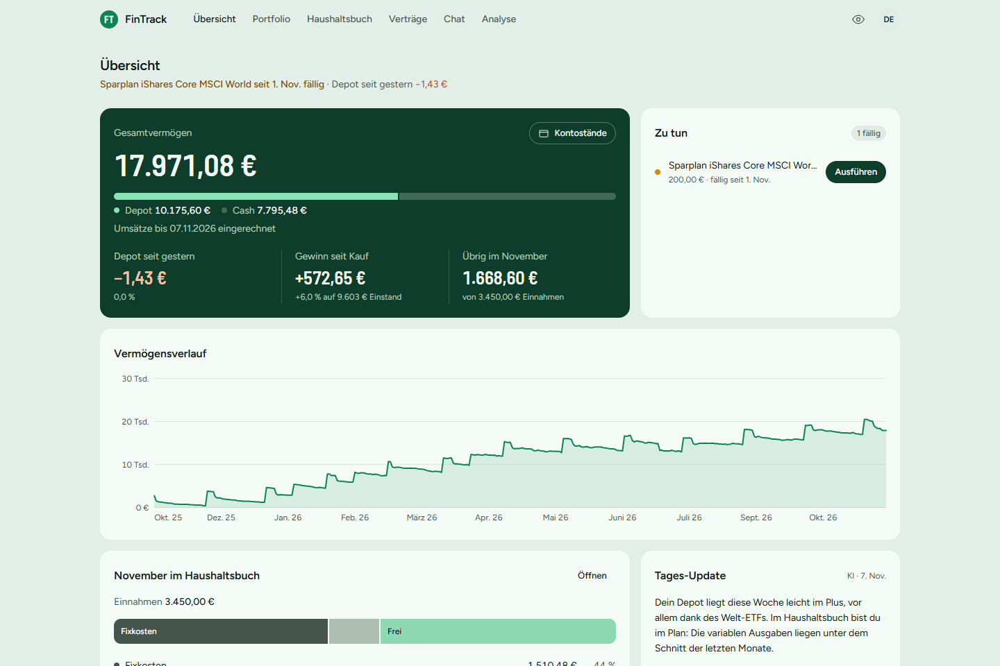
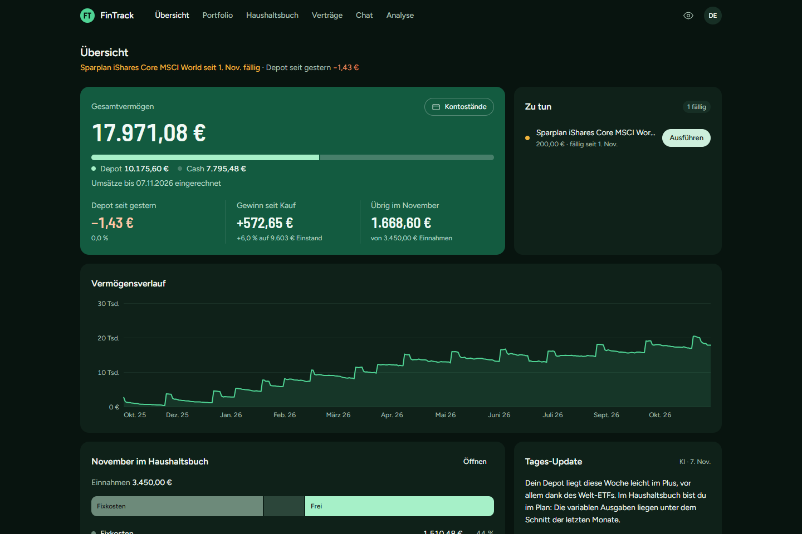
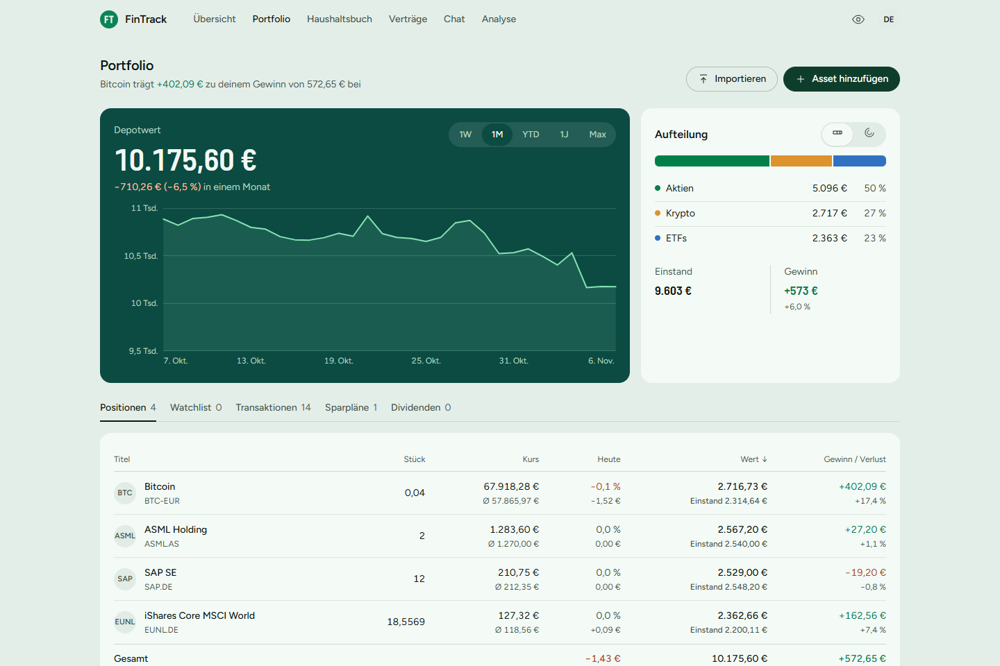
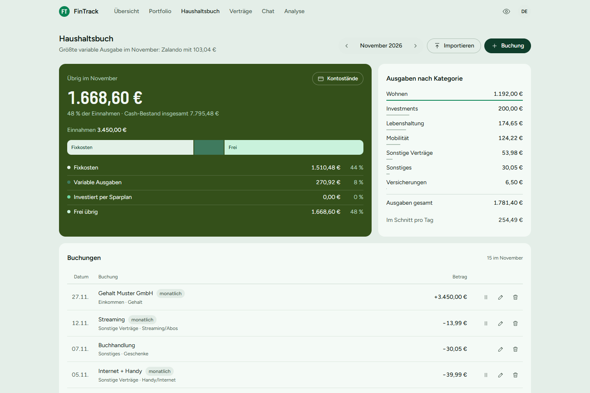
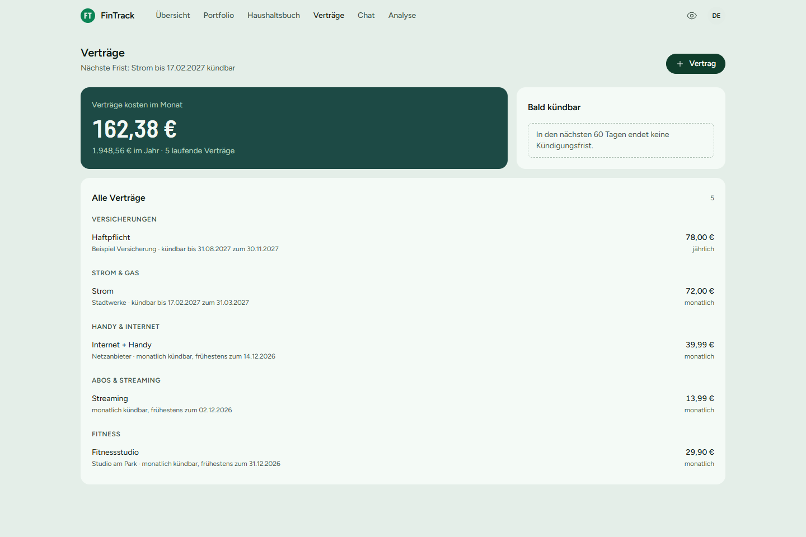
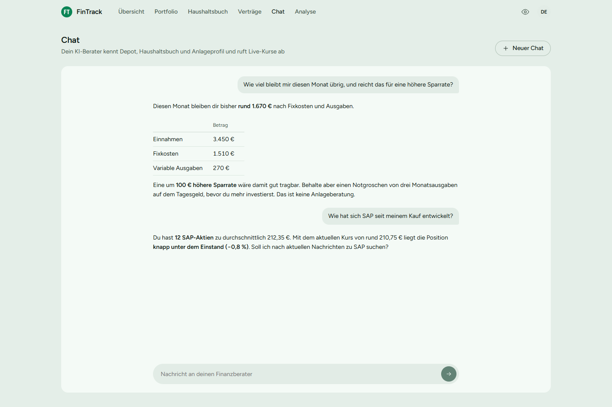
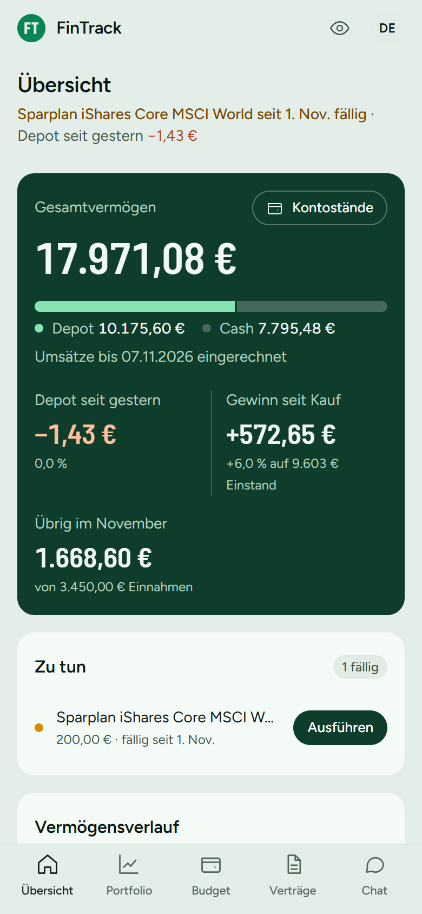

# FinTrack 💹

Eine selbst gebaute **Finanz-App für den Alltag**: Depot, Haushaltsbuch, Verträge und echte Kontostände an einem Ort, dazu ein KI-Finanzberater, der die eigenen Zahlen kennt. Kontoumsätze und Wertpapierabrechnungen der Bank lassen sich importieren, und am Ende steht ein Gesamtvermögen mit Verlauf über die Jahre. Die App läuft im Browser, lässt sich auf dem Handy installieren (PWA) und ist über einen eigenen MCP-Server auch aus Claude Desktop heraus nutzbar. Früher hieß das Projekt FinanceAdvisor.

**Live:** https://fintrack.vincentkoenig.ai *(Konten legt der Betreiber an)*



> Die Bilder zeigen ein erfundenes Beispielkonto, keine echten Finanzdaten. Nur die Kurse sind echt.

## Warum dieses Projekt?

Banking-Apps zeigen das Konto, Broker das Depot, und das Haushaltsbuch steht in einer Tabelle. Die Frage „Wie viel habe ich insgesamt, und wohin geht mein Geld?“ beantwortet keine davon. FinTrack führt alles zusammen, ohne die Daten einem fremden Finanz-Dienst zu überlassen: Die App läuft auf einem eigenen Server, und an die KI gehen keine Namen, Adressen oder Kontonummern.

Das Projekt ist außerdem ein Lernprojekt: Jeder Baustein, vom Datenbankschema bis zum Import von Bank-PDFs, ist kommentiert und mit Tests abgesichert, damit man am Ende erklären kann, wie er funktioniert.

## Features

### 🏠 Übersicht
- **Gesamtvermögen** aus live bewertetem Depot und Cash-Bestand, mit Aufteilung, der Veränderung seit gestern (Käufe und Verkäufe herausgerechnet) und dem Gewinn seit Kauf
- **Vermögensverlauf** über die Jahre: Depotwert und Kontostand für jeden Tag, beim Zeigen einzeln aufgeschlüsselt
- **Zu tun**: fällige Sparpläne direkt ausführen, bald endende Kündigungsfristen
- Monatsfluss (wohin das Einkommen geht), Tages-Update der KI, Bewegung im Depot und letzte Buchungen
- Hell und dunkel, mit einem Klick alle Beträge verbergen (zum Beispiel im Zug)



### 🏦 Kontostand und Umbuchungen
- **Echte Kontostände mit Datum eintragen**: Der Cash-Bestand rechnet vom neuesten Eintrag aus mit den Buchungen weiter, statt die Summe aller Buchungen als Kontostand zu zeigen. Im Dispo wird er vom Depot abgezogen
- **Abweichung als Kontrolle**: Bei jedem Eintrag steht, wie weit die Buchungen seit dem vorherigen Eintrag vom echten Konto abweichen. So fallen fehlende oder doppelte Umsätze sofort auf
- **Umbuchungen** zwischen eigenen Konten zählen für den Kontostand, aber nicht als Einnahme oder Ausgabe

### 📊 Portfolio
- Aktien, ETFs, Kryptowährungen und Edelmetalle kaufen und verkaufen, suchen per Name, Symbol oder ISIN (Euro-Börsen zuerst, Krypto als Euro-Paar wie BTC-EUR)
- Live-Kurse über **yfinance** in der Handelswährung, umgerechnet mit dem Wechselkurs des jeweiligen Tages
- **Ersatzquellen**, wenn yfinance ausfällt: Wechselkurse von der EZB, Krypto von CoinGecko, Tageskurse für Aktien und ETFs (XETRA, Paris, Amsterdam, USA) von Alpha Vantage. Ohne Live-Kurs gilt der letzte gespeicherte Schlusskurs
- **Wertverlauf aus den echten Käufen und Verkäufen** rekonstruiert, mit Zeiträumen (1W bis Max). Die Entwicklung rechnet Käufe heraus, damit ein Kauf nicht als Gewinn erscheint
- Aufteilung nach Anlageart, Watchlist, Transaktionen, Sparpläne und automatisch verbuchte Dividenden
- Ein täglicher Lauf nach US-Börsenschluss lädt Schlusskurse nach, holt ausgefallene Tage nach und verbucht Dividenden



### 📥 Abrechnungen und Depots importieren
- **Wertpapierabrechnungen als PDF**, einzeln, viele auf einmal oder **als ZIP-Archiv** der Bank. Die Reihenfolge ist egal, Verkäufe werden über alle Dateien nach Datum geprüft
- Persönliches (Name, Adresse, IBAN, Depot- und Kundennummern) wird **vor** dem Auslesen entfernt, den gesendeten Text kann man nachlesen
- **Prüfungen gegen die Abrechnung**: Stückzahl, Kurswert und Handelstag müssen im Dokument stehen, sonst korrigiert FinTrack die KI oder bittet um Prüfung. Kapitalmaßnahmen werden nicht als Kauf gebucht
- **Aktiensplits** werden eingerechnet (eine Tesla-Aktie von 2020 sind heute 15), weil auch die Kurshistorie um Splits bereinigt ist
- Lesbar auch bei PDFs, die statt Text nur interne Schriftzeichen-Codes enthalten (z.B. HypoVereinsbank)
- **Trade-Republic-Export** und CSV-Exporte von Krypto-Apps werden ohne KI gelesen

### 💰 Haushaltsbuch
- Einnahmen, Fixkosten und variable Ausgaben mit eigenen Haupt- und Unterkategorien, einmalig oder **wiederkehrend** (pausierbar, mit Enddatum). Wiederkehrende Einträge werden pro Monat live berechnet, nicht dupliziert
- „Übrig im Monat“ mit Monatsfluss, Ausgaben nach Kategorie und Tagesschnitt, Monate vor und zurück blättern
- **Kontoumsätze importieren** als CSV oder PDF-Kontoauszug: Umsätze nach Empfänger gruppiert, Dubletten und schon erfasste wiederkehrende Buchungen werden erkannt
- Kategorien kommen aus früheren Buchungen, **eigenen Regeln**, bekannten Händlern oder auf Wunsch von der KI. An OpenAI gehen dabei nur Empfängernamen, keine Beträge oder IBANs
- Kategorie einer Buchung ändern und auf alle gleich benannten übertragen



### 📄 Verträge
- Versicherungen, Strom, Handy, Abos und Fitnessstudio mit Laufzeit, Verlängerung und Kündigungsfrist
- FinTrack rechnet den **letzten Kündigungstag** aus und meldet bald endende Fristen in der Übersicht
- Kosten pro Monat und Jahr, Verknüpfung mit dem Haushaltsbuch, Vorschläge aus regelmäßigen Abbuchungen



### 🤖 KI-Finanzberater und Analyse
- **Chat** mit einem Berater, der Depot, Haushaltsbuch, Verträge und Anlageprofil kennt. Über **Function Calling** ruft er Live-Kurse und die eigenen Zahlen ab und sucht bei Bedarf aktuelle Nachrichten (**Tavily**)
- Antworten mit Tabellen und Listen, formatiert ohne fremdes HTML in der Seite. Der Verlauf bleibt gespeichert, an die KI geht ein gleitendes Fenster der letzten Nachrichten
- **Portfolio-Analyse** per Structured Output: Risiko, Streuung, Zusammenfassung und Empfehlungen. Rechenwerte wie der Gesamtwert kommen vom Server, nicht aus der KI



### 📱 Handy (PWA)
- Eine Oberfläche für Laptop und Handy: unten eine Navigation, Listen statt breiter Tabellen, Dialoge als Blatt von unten
- Installierbar als App mit eigenem Symbol. Der Service Worker speichert nur Programmdateien, nie Finanzdaten
- **Push-Benachrichtigungen** pro Gerät und pro Art einzeln schaltbar: Kündigungsfristen (14 und 3 Tage vorher), fälliger Sparplan, Tages-Update der KI, starke Kursbewegungen (Position ±5 %, Depot ±3 %) und erreichte Watchlist-Zielkurse. Die Kursprüfung läuft tagsüber alle 30 Minuten und hält ihre Daten im Arbeitsspeicher, damit sie die Datenbank nicht weckt. Nie zwischen 22 und 8 Uhr und nie mit Beträgen, weil Meldungen auf dem Sperrbildschirm stehen. Auf dem iPhone nur in der installierten App

<p align="center"></p>

### 👤 Konto und Sicherheit
- Login mit gehashtem Passwort und sicherem Session-Cookie. Jeder Nutzer sieht nur seine eigenen Daten, für jede Route geprüft
- Begrenzte Login-Versuche, Registrierung abschaltbar, Konten auch per Kommandozeile
- **Export und Import aller eigenen Daten** als JSON-Datei, damit ein Umzug jederzeit möglich ist

### 🔌 MCP-Server
- Stellt Portfolio, Haushaltsbuch und neue Buchungen als Tools für Claude Desktop bereit, mit derselben Berechnung wie die Web-App. Details in [`mcp_server/`](./mcp_server)

## Tech Stack


- **Flask** — REST-API-Backend, liefert außerdem das gebaute Frontend aus
- **SQLAlchemy** — ORM, PostgreSQL im Live-Betrieb / SQLite für die lokale Entwicklung
- **OpenAI API** — GPT-4o-mini für Chat (Function Calling) und Portfolio-Analyse (Structured Output)
- **Tavily** — Echtzeit-Websuche für aktuelle Finanznachrichten, als LLM-Tool eingebunden
- **Pydantic** — Structured-Output-Parsing für die Portfolio-Analyse
- **yfinance** — Kursdaten für Aktien, ETFs und Edelmetalle, historische Preise und Asset-Suche per Name
- **CoinGecko API** — Kryptowährungskurse
- **APScheduler** + **GitHub Actions** — täglicher Lauf für Kurse, Wechselkurse, Dividenden und Insights
- **MCP (Model Context Protocol)** — eigenständiger Server, der App-Daten als Tools für Claude Desktop bereitstellt
- **Gunicorn** — Produktions-WSGI-Server
- **werkzeug** — Passwort-Hashing und Sicherheit
- **python-dotenv** — sichere Verwaltung der API-Keys
- **React 19, TypeScript, Vite** — Frontend unter `/app`, mit React Router und TanStack Query; Diagramme als eigenes SVG, Styling mit reinem CSS und Design-Tokens
- **Vitest, Testing Library, MSW** — Frontend-Tests gegen eine nachgebaute API
- **Web App Manifest + eigener Service Worker** — PWA mit Offline-Seite und Update-Hinweis

## Architektur

```
 Browser / Handy (React-PWA unter /app)                Claude Desktop
        │  JSON über /api/v1, Session-Cookie                 │  MCP (stdio)
        ▼                                                    ▼
 ┌──────────────────────── Flask-App (Gunicorn, Docker) ──────────────────────┐
 │ auth · portfolio · budget · contracts · imports · chat · insights · admin  │
 │ gemeinsame Berechnung: Cash-Bestand, Monatsfluss, Wertverlauf, Fristen     │
 │ Scheduler: täglich Kurse, Wechselkurse, Dividenden, Tages-Update           │
 └───────┬───────────────────────┬───────────────────────────┬───────────────┘
         ▼                       ▼                           ▼
   PostgreSQL (Neon)      yfinance · CoinGecko         OpenAI · Tavily
   SQLite lokal           Kurse, Splits, Suche         nur maskierte Texte
```

### Warum diese Entscheidungen?

- **Kontostand als Ankerpunkt statt Summe aller Buchungen**: Ein Haushaltsbuch kennt nie jeden Euro. Der eingetragene Kontostand hält die Zahl ehrlich, und die Abweichung zwischen zwei Einträgen zeigt, wo Buchungen fehlen
- **Wiederkehrende Buchungen als eine Zeile**: Miete oder Gehalt stehen einmal in der Datenbank und werden pro Monat ausgewertet. Kein Job muss Zeilen erzeugen, und eine Änderung gilt sofort für alle Monate
- **Die KI liest, das Programm prüft**: Abrechnungen und Kontoauszüge liest ein Sprachmodell, weil jede Bank ihr eigenes Layout hat. Stückzahl, Kurswert, Datum und Wertpapier werden danach gegen das Dokument und die Kursdaten geprüft, und gebucht wird erst nach Bestätigung
- **Persönliches bleibt im Haus**: Vor jedem KI-Aufruf entfernt FinTrack Namen, Adressen und Nummern und zeigt den gesendeten Text an
- **Depotverlauf aus Transaktionen**: Der Wert jedes Tages ergibt sich aus den Stücken, die an diesem Tag im Depot lagen. Splits werden deshalb in die Stückzahl eingerechnet, so wie Yahoo sie in den Kursen bereinigt
- **Eine Berechnung für alle**: Web-App, Chat und MCP-Server nutzen dieselben Funktionen, nichts wird doppelt programmiert
- **Daten gehören dem Nutzer**: Export und Import aller Daten als Datei, nächtliches verschlüsseltes Backup mit Wiederherstellungstest

## Projektstruktur

```
FinTrack/
├── app.py                    # Einstiegspunkt für Gunicorn/lokal: baut die App und startet den Scheduler
├── fintrack/                  # Die eigentliche App als Paket
│   ├── __init__.py             # create_app(): Konfiguration, Datenbank, Blueprints
│   ├── config.py               # Einstellungen aus Umgebungsvariablen, Datenbank-URL
│   ├── extensions.py           # Gemeinsame Objekte: Datenbank, Migrationen, Login, Limiter, OpenAI-Client
│   ├── api.py                  # Eingabeprüfung (Pydantic) und einheitliche JSON-Fehler der API
│   ├── database.py             # flask upgrade-db: Migrationen ausführen, alte Datenbanken übernehmen
│   ├── models.py               # SQLAlchemy-Modelle + Pydantic-Schemas für Structured Output
│   ├── jobs.py                 # Täglicher Lauf (Kurse, Dividenden, Insights) im Hintergrund, Scheduler
│   ├── health.py               # Statuspunkt /healthz für Docker und Überwachung
│   ├── spa.py                  # Liefert das React-Frontend unter /app aus, / und alte Seitenadressen leiten dorthin
│   ├── auth/                   # Registrierung, Login/Session, Verifizierung, Profil, CLI (create-user, set-password)
│   ├── account/                # Export und Import aller eigenen Daten
│   ├── portfolio/              # Assets, Positionen, Watchlist, Sparpläne, Dividenden, KI-Analyse
│   ├── budget/                 # Haushaltsbuch: Routen + Berechnungslogik (auch vom MCP-Server genutzt)
│   ├── chat/                   # KI-Chat mit Function-Calling-Tools
│   ├── contracts/              # Verträge: Routen + Berechnung von Laufzeit und Kündigungsfrist
│   ├── imports/                # Import: Kontoumsätze (CSV, PDF), Abrechnungen (PDF), Trade Republic, Krypto
│   ├── insights/               # Täglicher KI-Insight
│   ├── admin/                  # Geschützte Endpoints zum manuellen Anstoßen der Jobs
│   └── market/                 # Marktdaten (yfinance, CoinGecko, Tavily) + zentraler Preis-Service
├── frontend/                     # React-Frontend (React, TypeScript, Vite), ausgeliefert unter /app
├── migrations/                   # Alembic-Migrationen (Schemaänderungen der Datenbank)
├── tests/                        # pytest: Unit- und Integrationstests (u.a. Zugriffsschutz für jede Route)
├── requirements.txt              # Abhängigkeiten der Haupt-App, alle Versionen fest gepinnt
├── requirements-dev.txt          # Zusätzlich für Tests (pytest, MCP-SDK)
├── Dockerfile                    # Container mit Frontend-Build und Gunicorn (Start über docker-entrypoint.sh)
├── deploy/                       # Eigener Server: Compose-Datei, Deploy-Skript, Einrichtung (deploy/README.md)
├── start.bat                     # Windows-Starter — migriert die Datenbank, baut das Frontend, startet den Server und öffnet den Browser
├── mcp_server/
│   ├── server.py                  # MCP-Server, stellt Portfolio-/Budget-Tools für Claude Desktop bereit
│   └── requirements.txt            # Abhängigkeiten der App plus MCP-SDK
├── docs/                          # Backup-Anleitung (BACKUP.md), Demo-Video
│   └── images/                      # Bilder für dieses README (Beispielkonto)
└── .github/workflows/             # CI-Tests (inkl. PostgreSQL) und nächtliches Datenbank-Backup
```

## API-Übersicht

Alle Routen liegen unter `/api/v1` und antworten mit JSON. Persönliche Daten liegen unter `/api/v1/me/...` — welcher Nutzer gemeint ist, erkennt der Server am Anmelde-Cookie, die URLs enthalten nie eine User-ID. Eingaben werden mit Pydantic geprüft; Fehler kommen einheitlich als `{"error": "...", "fields": {...}}` auf Deutsch zurück.

| Methode | Route | Beschreibung |
|--------|-------|-------------|
| `POST` | `/auth/register` | Registrieren (nur wenn `ALLOW_REGISTRATION=1`), Code per E-Mail |
| `POST` | `/auth/verify-email` | E-Mail mit Code bestätigen, danach angemeldet |
| `POST` | `/auth/resend-verification` | Neuen Code anfordern |
| `POST` | `/auth/login` · `/auth/logout` | Anmelden (setzt Session-Cookie) · Abmelden |
| `GET` · `PUT` | `/me` · `/me/settings` | Eigenes Profil · Anlage-Einstellungen speichern |
| `GET` | `/assets/search?query=` | Assets per Name, Symbol oder ISIN suchen — Ergebnisliste, bekannte Assets und Euro-Börsen zuerst, legt nichts an |
| `POST` | `/assets` | Ausgewählten Suchtreffer (`symbol`, `name`) als Asset anlegen und ein Jahr Kurse laden (201, bei vorhandenem Asset 200) |
| `GET` | `/assets/<id>` | Asset mit Live-Preis |
| `GET` · `POST` | `/me/positions` | Positionen mit Live-Preis · Kauf erfassen (bestehende Position wird ergänzt) |
| `POST` | `/me/positions/<asset_id>/buy` · `/sell` | Nachkauf · Verkauf |
| `GET` | `/me/asset-transactions` | Kauf-/Verkaufshistorie |
| `GET` | `/me/portfolio/history` | Täglicher Portfolio-Wert in Euro (`[{date, value}]`) vom ersten Kauf bis heute |
| `GET` · `POST` | `/me/analyses` | Bisherige KI-Analysen · neue Analyse erstellen |
| `GET` · `POST` · `DELETE` | `/me/watchlist` · `/me/watchlist/<asset_id>` | Watchlist |
| `GET` · `POST` | `/me/savings-plans` | Sparpläne |
| `DELETE` · `POST` | `/me/savings-plans/<id>` · `/execute` | Sparplan löschen · ausführen |
| `GET` | `/me/dividends` | Verbuchte Dividenden |
| `GET` · `POST` | `/me/categories` | Budgetkategorien |
| `PUT` · `DELETE` | `/me/categories/<id>` | Kategorie umbenennen oder verschieben · löschen (nicht möglich, solange Buchungen daran hängen) |
| `GET` · `POST` · `DELETE` | `/me/category-rules` · `/me/category-rules/<id>` | Eigene Regeln für den Kontoimport |
| `POST` | `/me/categories/init-defaults` | Standardkategorien nachträglich anlegen |
| `GET` · `POST` | `/me/transactions` | Buchungen (optional `?month=JJJJ-MM`) · neue Buchung |
| `PUT` · `DELETE` | `/me/transactions/<id>` | Kategorie und Beschreibung ändern (auf Wunsch für alle gleich benannten) · löschen |
| `POST` | `/me/transactions/<id>/toggle-pause` | Wiederkehrende Buchung pausieren/fortsetzen |
| `GET` | `/me/budget/summary` | Cash-Bestand (vom Kontostand aus), Stand der Umsätze und aktueller Monat |
| `GET` · `POST` | `/me/balances` | Eingetragene Kontostände mit Abweichung zu den Buchungen · Kontostand eines Tages eintragen |
| `DELETE` | `/me/balances/<id>` | Kontostand löschen |
| `GET` | `/me/wealth/history` | Gesamtvermögen je Tag (`[{date, cash, depot, total}]`) |
| `POST` | `/me/import/bank/preview` | CSV-Export der Bank lesen (Feld `file`, optional `mapping`): Umsätze mit Status `new` / `covered` (deckt eine wiederkehrende Buchung ab) / `duplicate` und Kategorievorschlag, speichert nichts |
| `POST` | `/me/import/bank/pdf/preview` | Kontoauszug als PDF: persönliche Angaben entfernen, Umsätze per OpenAI auslesen, dann dieselbe Vorschau wie beim CSV-Import (mit `sent_text`) |
| `POST` | `/me/import/bank/categorize` | Kategorievorschläge der KI für Empfänger ohne Kategorie (nur Namen und Richtung gehen an OpenAI) |
| `POST` | `/me/import/bank/commit` | Bestätigte Umsätze als Buchungen übernehmen (alles oder nichts, schon importierte werden übersprungen) |
| `POST` | `/me/import/depot/preview` | PDF-Abrechnung lesen (je Datei; ZIPs entpackt die Seite im Browser, Verkäufe prüft sie über alle Dateien): persönliche Angaben werden entfernt, der Rest per OpenAI (Structured Output) ausgelesen; Stück, Kurswert und Datum gegen das Dokument geprüft, spätere Aktiensplits eingerechnet, ISIN-Suche mit Rückfall auf den Namen, Kurs inkl. Gebühren, Status `new` / `duplicate` / `unknown` / `insufficient` und dem gesendeten Text, speichert nichts |
| `POST` | `/me/import/crypto/preview` | Trade-Republic-Export oder CSV-Export einer Krypto-App (z. B. Bison) ohne KI lesen: nur Käufe/Verkäufe, Kryptowährung als Euro-Paar (`BTC` → `BTC-EUR`), gleiche Vorschau wie bei Abrechnungen; bei unbekannten Spalten `columns`, dann `?mapping=` |
| `POST` | `/me/import/depot/commit` | Bestätigte Käufe/Verkäufe zeitlich geordnet ins Depot buchen, fehlende Assets anlegen (alles oder nichts) |
| `GET` · `POST` | `/me/contracts` | Verträge mit Status, Kündigungstag und Kosten pro Monat/Jahr (sortiert nach Frist) · neuer Vertrag |
| `PUT` · `DELETE` | `/me/contracts/<id>` | Vertrag bearbeiten · löschen |
| `GET` | `/me/contracts/suggestions` | Regelmäßige Abbuchungen aus importierten Umsätzen (monatlich bis jährlich, ähnlicher Betrag), die noch kein Vertrag sind |
| `POST` · `DELETE` | `/me/contracts/<id>/cancel` | Als gekündigt markieren (ohne `end_date` zum nächstmöglichen Termin) · Kündigung zurücknehmen |
| `POST` · `DELETE` | `/me/contracts/<id>/booking` | Mit dem Haushaltsbuch verknüpfen (`category_id`: neue Fixkosten-Buchung, Beitrag anteilig pro Monat · `transaction_id`: vorhandene wiederkehrende Buchung) · Verknüpfung lösen |
| `POST` · `GET` | `/me/chat` · `/me/chat/history` | KI-Chat · Verlauf |
| `GET` | `/me/insight` | Letzter täglicher KI-Insight |
| `GET` | `/me/export` | Alle eigenen Daten als JSON-Datei herunterladen |
| `POST` | `/me/import` | Exportdatei in ein leeres Konto einspielen (alles oder nichts) |
| `POST` | `/admin/run-daily-jobs` | Kompletten täglichen Lauf im Hintergrund starten (202, bei laufendem Job 409; Header `X-Admin-Key`) |
| `POST` | `/admin/update-prices` · `/admin/check-dividends` · `/admin/generate-insights` | Einzelne Jobs im Hintergrund starten (Header `X-Admin-Key`) |
| `GET` | `/admin/jobs/status` | Zustand und Ergebnis des letzten Laufs (Header `X-Admin-Key`) |
| `POST` | `/admin/assets/<id>/prices` | Historischen Preis manuell eintragen (Header `X-Admin-Key`) |

## Erste Schritte

**1. Repository klonen**
```bash
git clone https://github.com/vincentkoenig/FinanceAdvisor.git
cd FinanceAdvisor
```

**2. Abhängigkeiten installieren**
```bash
pip install -r requirements.txt
```

**3. `.env`-Datei anlegen**
```
OPENAI_API_KEY=dein_openai_api_key
COINGECKO_API_KEY=dein_coingecko_api_key
TAVILY_API_KEY=dein_tavily_api_key
```
> API-Keys gibt es unter [platform.openai.com](https://platform.openai.com/api-keys), [coingecko.com](https://www.coingecko.com/en/api) und [tavily.com](https://tavily.com)
>
> `DATABASE_URL` ist optional — ist sie nicht gesetzt, nutzt die App automatisch eine lokale SQLite-Datenbank.

Optionale Variablen:

| Variable | Zweck |
|---|---|
| `SECRET_KEY` | Signiert die Anmelde-Cookies. **In Produktion Pflicht** (sonst startet die App nicht). Lokal empfohlen, sonst ist man nach jedem Neustart abgemeldet. Erzeugen mit `python -c "import secrets; print(secrets.token_hex(32))"` |
| `ALLOW_REGISTRATION=1` | Erlaubt neue Konten über die Startseite. Standard: geschlossen — Konten dann per `create-user` anlegen (siehe unten). |
| `ADMIN_API_KEY` | Schlüssel für die Routen unter `/api/v1/admin/...` (Header `X-Admin-Key`). Ohne ihn sind diese Endpoints gesperrt. |
| `VAPID_PUBLIC_KEY`, `VAPID_PRIVATE_KEY` | Schlüsselpaar für Push-Benachrichtigungen, einmalig erzeugen mit `flask --app app make-vapid-keys`. Ohne sie zeigt die App, dass Push nicht eingerichtet ist. Optional `VAPID_SUBJECT` (mailto:- oder https-Adresse als Kontakt für die Push-Dienste). |
| `FLASK_DEBUG=1` | Debug-Modus beim lokalen Start mit `python app.py`. Wird automatisch abgeschaltet, wenn der Server im Netzwerk erreichbar ist. |
| `FLASK_HOST=0.0.0.0` | Server im lokalen Netzwerk erreichbar machen, z.B. für Tests vom Handy. Standard ist nur dieser PC (`127.0.0.1`). |

Einen manuellen Job startest du dann so (er läuft im Hintergrund, das Ergebnis steht danach unter `/api/v1/admin/jobs/status`):
```bash
curl -X POST -H "X-Admin-Key: dein_schluessel" http://localhost:5000/api/v1/admin/update-prices
```

**4. Datenbank anlegen und App starten**
```bash
python -m flask --app "fintrack:create_app()" upgrade-db
python app.py
```
`upgrade-db` legt die lokale SQLite-Datenbank im `instance/`-Ordner an bzw. bringt sie per Migration auf den neuesten Stand. Alternativ unter Windows: Doppelklick auf `start.bat` — das erledigt beides und öffnet den Browser. Der Preis-Scheduler startet im Hintergrund.

**Schema ändern:** Nach einer Änderung in `fintrack/models.py` eine Migration erzeugen, prüfen und mit committen:
```bash
python -m flask --app "fintrack:create_app()" db migrate -m "kurze Beschreibung"
```
`upgrade-db` bricht ab, wenn Datenbank und Modelle nach der Migration nicht übereinstimmen — eine vergessene Migration fällt so beim Start auf, statt still Fehler zu verursachen.

**Konto anlegen bzw. Passwort zurücksetzen** (solange die Registrierung geschlossen ist). Das Passwort wird verdeckt abgefragt; `set-password` meldet das Konto zusätzlich auf allen Geräten ab:
```bash
python -m flask --app "fintrack:create_app()" create-user deine@email.de
python -m flask --app "fintrack:create_app()" set-password deine@email.de
```

**5. Frontend bauen und im Browser öffnen**

Das Frontend (React, TypeScript, Vite) liegt in `frontend/` und braucht Node 24 (siehe `.node-version`). `start.bat` baut es unter Windows automatisch; von Hand:
```bash
cd frontend
npm ci
npm run build    # baut nach frontend/dist; Flask liefert das unter http://localhost:5000/app/ aus
npm run dev      # Entwicklungsserver auf http://localhost:5280/app/, leitet /api an Flask auf Port 5000 weiter
npm test         # Tests (Vitest, Testing Library, MSW)
```
Danach http://localhost:5000 öffnen (leitet nach `/app/`). Auf dem Smartphone lässt sich die App über „App installieren“ (Chrome) bzw. „Zum Home-Bildschirm“ (Safari) als PWA installieren.

**Als Container (Docker)**

Das `Dockerfile` baut Frontend und Backend in ein Image; die Datenbank bleibt außerhalb (z.B. Neon). Die Umgebungsvariablen kommen zur Laufzeit dazu, nie ins Image:
```bash
docker build -t fintrack .
docker run --env-file .env -p 8000:8000 fintrack   # http://localhost:8000/app/
```
Beim Start laufen zuerst die Migrationen, dann Gunicorn mit einem Worker (wegen des Schedulers) und vier Threads. `GET /healthz` meldet, ob die App läuft, ohne die Datenbank zu wecken; `GET /healthz?db=1` prüft zusätzlich die Datenbankverbindung.

**6. Tests**
```bash
pip install -r requirements-dev.txt
python -m pytest          # Backend: Unit- und Integrationstests, auch gegen PostgreSQL in der CI
cd frontend && npm test  # Frontend: Vitest, Testing Library, MSW
```

**7. (Optional) MCP-Server mit Claude Desktop verbinden**

Die komplette Anleitung dazu findet sich in [`mcp_server/`](./mcp_server) — kurz zusammengefasst: einen Eintrag in der `claude_desktop_config.json` anlegen, der auf `mcp_server/server.py` verweist und den Python-Interpreter der eigenen virtuellen Umgebung nutzt, danach Claude Desktop neu starten.

## Deployment

Die App läuft unter https://fintrack.vincentkoenig.ai auf einem eigenen VPS (Hostinger, Frankfurt) — Aufbau und Einrichtung siehe [`deploy/README.md`](./deploy/README.md):
- **Docker**-Container (`Dockerfile`) hinter dem vorhandenen **Traefik**, der das HTTPS-Zertifikat automatisch holt; beim Start laufen zuerst die Migrationen, dann Gunicorn
- **Automatisches Ausrollen:** Nach jedem Merge auf `main` laufen die Tests, danach aktualisiert GitHub Actions den Server über einen Deploy-Schlüssel, der nur das Deploy-Skript ausführen darf, und prüft `/healthz?db=1` von außen
- **PostgreSQL**-Datenbank bei [Neon](https://neon.tech) in Frankfurt (kostenloser Tarif), verbunden über die Umgebungsvariable `DATABASE_URL`
- Geheimnisse in `/opt/fintrack/.env` auf dem Server (nur für root lesbar) und als GitHub-Secrets, nie im Repository
- Täglicher Lauf (Kurse, Dividenden, Insights) über den eingebauten Scheduler um 22:30 Uhr deutscher Zeit; GitHub Actions ([`daily-jobs.yml`](./.github/workflows/daily-jobs.yml), 21:30 UTC) startet ihn zusätzlich als Absicherung über `/api/v1/admin/run-daily-jobs` (Repository-Secret `ADMIN_API_KEY`, derselbe Wert wie auf dem Server) — eine Sperre verhindert doppelte Läufe
- Nächtliches, verschlüsseltes Datenbank-Backup mit automatischem Wiederherstellungstest über GitHub Actions — Einrichtung und Wiederherstellung siehe [`docs/BACKUP.md`](./docs/BACKUP.md)

## Was ich dabei gelernt habe

- Aufbau einer versionierten Flask-REST-API (`/api/v1`) mit über 60 Endpoints, Pydantic-Validierung und einheitlichen Fehlerantworten
- Integration von OpenAI Function Calling, damit die KI eigenständig Live-Daten abruft, im Web sucht (über Tavily) und auch mehrere gleichzeitige Tool-Aufrufe in einem Zug korrekt verarbeitet
- Nutzung von Pydantic Structured Output (`response_format`) für zuverlässiges, schema-konformes JSON von LLMs, während numerisch kritische Werte (wie der Gesamtportfoliowert) serverseitig berechnet statt der LLM-Arithmetik überlassen werden
- Entwurf einer relationalen SQLAlchemy-Datenbank mit 17 verknüpften Modellen und Alembic-Migrationen, inklusive einer zweistufigen, selbstreferenzierenden Kategorienstruktur für das Haushaltsbuch
- Modellierung wiederkehrender Buchungen (Einnahmen/Ausgaben) als einzelne Datenbankzeilen, die beim Lesen pro Monat live ausgewertet werden, statt Zeilen zu duplizieren — dadurch keine Abhängigkeit von einem Scheduler zur Generierung
- Umsetzung sicherer Nutzerauthentifizierung mit Passwort-Hashing über `werkzeug`
- Ausführung von Hintergrundaufgaben mit APScheduler innerhalb eines Flask-App-Kontexts, inklusive Lückenfüllungs-Logik für verpasste Preisaktualisierungen, sowie Sicherstellung, dass der Scheduler auch unter Gunicorn statt dem Flask-Entwicklungsserver zuverlässig läuft
- Abruf und Abgleich von Live-Finanzdaten über mehrere APIs und Währungen hinweg (yfinance, CoinGecko, USD-→-EUR-Umrechnung), sowie Debugging von Chart-Artefakten durch Wochenenden/Feiertage und durch die Anwendung aktueller Wechselkurse auf historische Preise
- Iteratives Prompt Engineering mit adaptivem Antwortformat, durch direkten Vergleich mit ChatGPT-Ausgaben
- Verwaltung von LLM-Kontext und Tokenkosten mittels Sliding Window über den Chatverlauf
- Auslagerung gemeinsamer Geschäftslogik (`fintrack/budget/service.py`), sodass dieselbe Berechnung sowohl von der Flask-Web-App als auch von einem unabhängigen MCP-Server genutzt wird, ohne Logik zu duplizieren
- Aufbau und Debugging eines Model-Context-Protocol-Servers von Grund auf — Lösung von Flask-App-Kontext-Anforderungen, absoluter Pfadauflösung (ein MCP-Client kann den Server aus einem beliebigen Arbeitsverzeichnis heraus starten) und Auflösung des richtigen virtuellen-Umgebungs-Interpreters für Claude Desktop
- Umsetzung eines stimmigen, theme-fähigen „Glas"-Designsystems mittels CSS Custom Properties, `backdrop-filter` und geschichteter Transparenz über eine komplette mehrseitige Anwendung hinweg
- Nachträgliche Anpassung eines bestehenden Desktop-Layouts für Mobilgeräte: eine untere Tab-Leiste mit „Mehr"-Overflow-Menü, Umwandlung dichter Datentabellen in gestapelte Karten über `data-label`-Attribute und CSS, sowie Debugging realer Responsive-Probleme (ein fehlender Viewport-Meta-Tag, der sämtliche Media Queries stillschweigend deaktivierte; sich stapelndes Padding über verschachtelte Container hinweg)
- Umbau der App in eine installierbare Progressive Web App mit eigenem Manifest, generiertem Icon-Set und einem bewusst minimalen Service Worker (kein Offline-Caching, da die App auf Live-Kurs- und Chat-Daten angewiesen ist)
- Zusammenführung einer eigenständigen Seite (Watchlist) in eine bestehende Seite als Tab-Ansicht, ohne das Backend anzufassen, mit sorgfältiger Konsolidierung von Navigation und JavaScript-Zustand zur Vermeidung von Variablenkonflikten
- Migration von SQLite zu einem dualen SQLite/PostgreSQL-Setup, gesteuert über eine Umgebungsvariable, sowie Deployment auf Render mit Gunicorn, inklusive Behebung eines Schedulers, der beim Wechsel vom Flask-Entwicklungsserver zu einem WSGI-Server stillschweigend aufgehört hatte zu laufen
- Umzug von Render auf einen eigenen VPS ohne Kaltstart: Docker-Image mit Healthcheck, der die Datenbank nicht weckt, Traefik für HTTPS, abgesicherter Server (Firewall, nur SSH-Schlüssel) und automatisches Ausrollen über einen eingeschränkten Deploy-Schlüssel
- Trennung von Verantwortlichkeiten über mehrere Module hinweg (Routen, Modelle, Services, Scheduler, Tools, Budget-Logik)
- Schrittweiser Umbau der Jinja-Seiten zu einer React-/TypeScript-PWA in kleinen Pull Requests, parallel unter `/app`, bis zur Umstellung — mit klickbarem Prototyp vorab, Tests gegen eine nachgebaute API (MSW) und einem eigenen Service Worker, der bewusst keine Finanzdaten auf dem Gerät speichert
- Kontostand als Ankerpunkt statt Summe aller Buchungen: echte Kontostände mit Datum, Rückrechnung für den Verlauf und eine Abweichung zwischen zwei Einträgen, mit der sich ein Import von zwei Jahren Kontoumsätzen gegen das echte Konto abgleichen ließ
- Robustes Auslesen von Bankdokumenten: IBM-Schriftzeichen-Codes in HVB-PDFs übersetzen, Persönliches vor dem KI-Aufruf entfernen, typische Fehler des Sprachmodells (Blattnummer als Stückzahl, verdrehte Daten) gegen das Dokument prüfen und Aktiensplits einrechnen, bis 71 echte Abrechnungen genau den Bestand der Bank ergaben
- Screenshots für dieses README mit einem erfundenen Beispielkonto in einer Wegwerf-Datenbank und Chrome ohne Fenster (DevTools-Protokoll), damit keine echten Finanzdaten in ein öffentliches Repository gelangen
